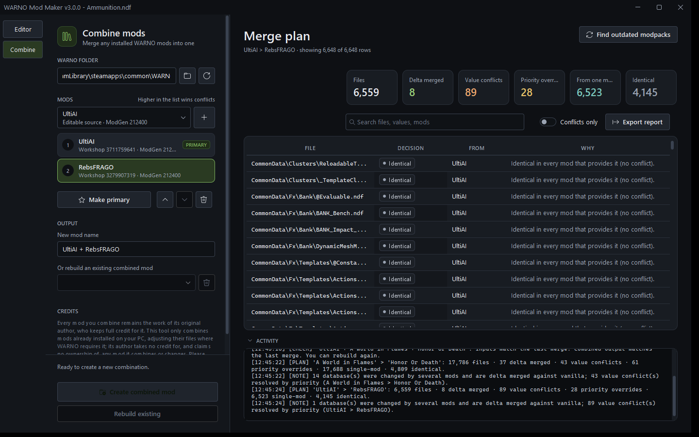
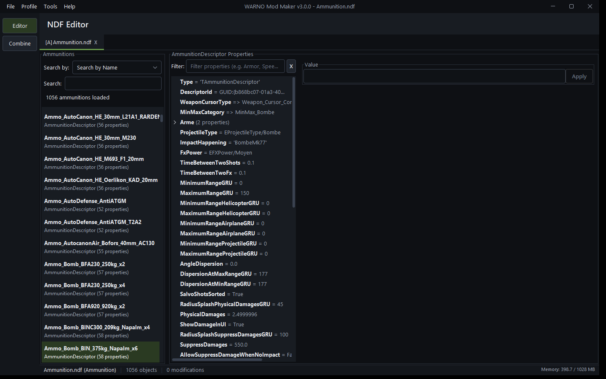

# WARNO Mod Maker (UltiMod)

A Windows tool for WARNO modders with two workspaces:

- **Editor** — open WARNO's NDF files and edit units, weapons, ammunition and more, one value at a time or in bulk.
- **Combine** — merge any installed WARNO mods into one mod that loads in the current game, including mods made for older WARNO versions.





---

## Download

Get `WARNO-Mod-Maker.zip` from the [latest release](https://github.com/Samy109/WARNOUltiMod/releases/latest), extract it anywhere, and run `WARNO-Mod-Maker.exe`. Java is included; nothing else needs installing.

---

## Combine

Pick installed mods (Workshop subscriptions or your own editable mods in `Mods\`), put them in priority order, and build. The first mod in the list is the primary; higher in the list wins conflicts.

**How a combination is built**

1. Each mod's changes are measured against the vanilla WARNO it was made for.
2. Changes from different mods are merged value by value. Independent changes to the same database are all kept; where two mods change the same value, the higher-priority mod wins and the plan lists the conflict.
3. The combined mod is generated through Eugen's own SDK (`CreateNewMod`, `GenerateMod`), then loaded by WARNO's headless generator **twice**. The second load must reuse every database as built — the same check the game makes when it starts — so a combination WARNO would reject ("No writable component found") fails here with the database named, instead of shipping.
4. The combined mod is activated in WARNO's mod list, and the mods it contains (and older combinations of them) are deactivated, so the game never starts it beside one of its own sources.

**Old mods are brought up to date**

A mod made for an earlier WARNO version is carried over to the installed one before merging. Its changes are applied to the current game's databases, and its data is reshaped the way WARNO's update reshaped vanilla's:

- classes and properties WARNO renamed,
- properties WARNO moved (for example `Name`, `Caliber` and four more moved from each weapon's ammunition onto the mounted weapon),
- properties WARNO now requires and removed,
- objects, models and registrations (unit mimetics, transported infantry) the mod still uses that WARNO deleted or renamed — removed models are declared again as source so WARNO builds them.

These rules are learned from the vanilla data of both versions, which WARNO keeps on disk, so it works for any version WARNO still has — including the older `Glad.dat` releases from before November 2026.

**The merge plan**

Before building, the plan shows every file the combined mod will contain and how each one is produced — taken from one mod, delta merged, a value conflict resolved by priority, or identical in several mods. Search it, show conflicts only, or export it as JSON.

**Keeping combinations current**

- **Find outdated modpacks / Update modpacks** — after a WARNO update or a Workshop update to one of its mods, rebuild a combination with the same mods and order.
- **Rebuild existing** — rebuild a combination you made before (records from WARNO UltiAI MODerator are supported).
- **Delete combined mod** — removes it from both `Mods\` and `Saved Games\...\mod\`, with any leftovers, and from WARNO's mod list.

**Safety**

Every file is staged and SHA-256 verified before it replaces anything, and an interrupted or cancelled build is rolled back to the previous output. Combined mods carry the installed game's own database fingerprints, so a source mod with an out-of-date `Config.ini` doesn't make the combination look out of date.

**Credits**

Every mod you combine remains the work of its original author, who keeps full credit for it. This tool takes no credit for, and claims no ownership of, any mod it combines or changes. Please support the original authors on the Steam Workshop.

---

## Editor

- **Open files** with File → Open (Ctrl+O). Supports UniteDescriptor, WeaponDescriptor, Ammunition, MissileDescriptors, BuildingDescriptors, DamageResistance, FireDescriptor, SmokeDescriptor, sound and effect files and more, each in its own tab.
- **Browse and search** objects by name, property, unit type, weapons, mobility, role, specialty or tag, and edit any value in place.
- **Mass Modify** (Tools) — change a property across many objects at once: set, add, multiply or change by a percentage, filtered by tags or names, with a preview first. Paths support wildcards and indexes, e.g. `ModulesDescriptors[*].MaxSpeed`.
- **Create Complete Entity** — create a new unit across UniteDescriptor, WeaponDescriptor and Ammunition with consistent references and new GUIDs.
- **Additive Operations** — add objects, modules, properties or list elements.
- **Create Manual List** and the **Cross-System Integrity Checker** for references between files.
- **Profiles** — save a set of modifications as JSON, load it on another file or after a game update, and edit it in the JSON Profile Editor.

Files are written back with their original formatting.

| Goal | Property path | Operation | Filter |
|------|---------------|-----------|--------|
| More health for every unit | `MaxPhysicalDamages` | Multiply by 1.5 | — |
| Faster recon | `ModulesDescriptors[*].MaxSpeed` | Percentage +20 | Tag: Recon |
| Thicker tank armor | `ModulesDescriptors[*].BlindageProperties.ArmorThickness` | Set to 25 | Tag: Tank |

---

## Building from source

Requires JDK 25 on Windows.

```bat
set "CUSTOM_JAVA_HOME=C:\Program Files\Java\jdk-25"
build.bat
"%CUSTOM_JAVA_HOME%\bin\java" --sun-misc-unsafe-memory-access=allow -Xmx6192m -jar WarnoModMaker-fat.jar
```

`distribute.bat` builds the standalone app in `build\distribution\WARNO-Mod-Maker` and the release archive `WARNO-Mod-Maker.zip`.

| Folder | Contents |
|--------|----------|
| `src/com/warnomodmaker/gui` | Editor windows and dialogs; `gui/combine` is the Combine workspace |
| `src/com/warnomodmaker/model`, `parser` | NDF text model, parser and writer used by the editor |
| `src/com/warnomodmaker/combine` | Combine engine: mod scanning, planning, merging, version migration, WARNO SDK and validation |
| `src/com/warnomodmaker/combine/ndf` | Compiled NDF database reader, writer and merger |
| `src/test/java` | Tests |

---

## Troubleshooting

- **WARNO isn't found** — choose the WARNO folder (the one with `WARNO.exe`) with the folder button in Combine.
- **A build fails with a WARNO error** — the log names the database and the mod involved; the previous output is restored automatically.
- **The game says mods are incompatible** — in WARNO's mod menu, leave only the combined mod enabled. Building with this version does this for you.
- **Out of memory on very large edits** — run the jar with a larger `-Xmx`.

Bug reports and requests: [GitHub Issues](https://github.com/Samy109/WARNOUltiMod/issues).

---

## License

MIT License.

WARNO and its NDF format are made by Eugen Systems. Thanks to the WARNO modding community for testing and feedback.
